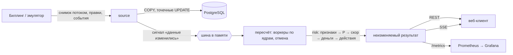

# Контур удержания · для aéza

Внутренний сервис aéza для маркетологов: показывает клиентов под риском оттока, причину простыми словами, ожидаемую потерю в евро и одно действие с ценой. Кейс и критерии: [docs/case.md](docs/case.md), решения: [docs/adr/](docs/adr/).

## Для жюри

Прод: **https://nihao-churn.duckdns.org** (публичный домен, TLS). Пароли учёток — в материалах сдачи, в репозитории их нет.

| Роль (логин) | Что видит и делает |
|---|---|
| `marketer` | очередь клиентов под риском, карточка клиента с причинами и действием, сводка |
| `analyst` | то же + «Модель» (веса, предпросмотр, применение), «Источник» (снимок, эмулятор биллинга), «О модели» |
| `jury` | все пути, для проверки |
| `secure` | вход через Keycloak (кнопка «Войти через SSO»): пароль + TOTP, ключ доступа добавляется в консоли аккаунта |

Права проверяются на сервере для каждой операции: маркетолог не меняет модель и через API.

### Демо за 6 шагов

Полный сценарий с цифрами — [docs/demo-script.md](docs/demo-script.md).

1. [Очередь](https://nihao-churn.duckdns.org/queue) (`marketer`): клиенты по ожидаемой потере, переключатель на скор.
2. Карточка клиента (клик по строке очереди): причины по вкладу, формула услуги, действие и сколько евро оно снимет.
3. [Модель](https://nihao-churn.duckdns.org/model) (`analyst`, второе окно): сдвинуть вес, посмотреть предпросмотр, применить — очередь у маркетолога перестроится без перезагрузки.
4. [Источник](https://nihao-churn.duckdns.org/source) (`analyst`): эмулятор биллинга или правка услуги — потеря в очереди меняется.
5. Инженерия: [Swagger](https://nihao-churn.duckdns.org/api/v1/docs), [Grafana](https://nihao-churn.duckdns.org/grafana/), [О модели](https://nihao-churn.duckdns.org/about).

### Где смотреть каждый критерий

| Критерий (`docs/scale.md`) | На проде | В репозитории |
|---|---|---|
| Бизнес-польза: кому, почему, сколько евро | [/queue](https://nihao-churn.duckdns.org/queue), карточка клиента, [/tasks](https://nihao-churn.duckdns.org/tasks), [/summary](https://nihao-churn.duckdns.org/summary) | [docs/case.md](docs/case.md), [docs/model.md](docs/model.md), `backend/internal/risk`, `frontend/src` |
| Обоснованность модели | [/about](https://nihao-churn.duckdns.org/about), [/model](https://nihao-churn.duckdns.org/model) | [docs/model.md](docs/model.md), [docs/model-rules.md](docs/model-rules.md), [docs/model-check.md](docs/model-check.md) (прокрутка 30 суток против простых правил, `make backtest`), оракул `tools/oracle`, golden-тесты `testdata/golden` |
| Архитектура и расширяемость | Helm/k3s: домен с TLS; Swagger [/api/v1/docs](https://nihao-churn.duckdns.org/api/v1/docs) | [docs/architecture.md](docs/architecture.md), чарт [deploy/helm/churn](deploy/helm/churn), [values.yaml](deploy/helm/churn/values.yaml), [api/openapi.yaml](api/openapi.yaml) |
| Метрики и нагрузка | [Grafana /grafana/](https://nihao-churn.duckdns.org/grafana/) (дашборд `churn`), `/metrics` по токену, Prometheus | [deploy/grafana](deploy/grafana), [deploy/prometheus](deploy/prometheus), замеры [docs/load/](docs/load/README.md) (цели частично не достигнуты, числа честные) |
| Вход и роли | экран входа, «Войти через SSO» | [deploy/keycloak/churn-realm.json](deploy/keycloak/churn-realm.json), раздел «Вход через SSO» ниже |
| Как добавить признак | — | раздел «Как добавить признак» ниже |

## Встроить в контур aéza

Настройки чарта [deploy/helm/churn/values.yaml](deploy/helm/churn/values.yaml) (свой файл — `helm upgrade -f свой.yaml`):

| Что подключить | Ключи `values.yaml` |
|---|---|
| Домен и TLS | `domain`, `ingress.className`, `ingress.certResolver` или `ingress.tlsSecret` |
| Источник данных (REST биллинга) | `env.BILLING_URL`, `env.BILLING_POLL_SECONDS`; токен — `secretEnv.BILLING_TOKEN` |
| OIDC (SSO) | `env.OIDC_ISSUER_URL`, `env.OIDC_DISCOVERY_URL`, `env.OIDC_CLIENT_ID`, `env.OIDC_REDIRECT_URL`; секрет — `secretEnv.OIDC_CLIENT_SECRET` |
| Prometheus | `serviceMonitor.enabled: true`, `serviceMonitor.interval`, `serviceMonitor.tokenSecret` (Secret с ключом `token` — `METRICS_TOKEN`) |
| Своя база | `postgres.enabled: false`, `postgres.externalUrl` |
| Секреты вручную | `existingSecret` вместо `secretEnv` |

Роль в SSO берётся из claim `roles` ID-токена (`marketer`, `analyst`). Развёртывание и откат — [deploy/k3s](deploy/k3s), описание — [docs/architecture.md](docs/architecture.md).

## Запуск локально

Нужен Docker с Compose. Три команды:

<!-- quickstart:start -->
```sh
cp .env.example .env
# задайте в .env пароли и токены (случайное значение: openssl rand -hex 16)
docker compose up -d
```
<!-- quickstart:end -->

Пустые `POSTGRES_PASSWORD` и `ADMIN_PASSWORD` — Compose или приложение не стартуют и называют переменную. База наружу не публикуется, снаружи доступен только порт приложения `8080`. Данные лежат в томе и переживают `docker compose down` (без `-v`).

## Что проверить за минуту

- `curl -fsS http://localhost:8080/healthz` отвечает `200`.
- `http://localhost:8080/` — веб-клиент (если фронт ещё не собран, страница «фронт не собран»).
- `http://localhost:8080/api/v1/docs` — Swagger по контракту `api/openapi.yaml`.
- Вход: логин `ADMIN_LOGIN` и пароль `ADMIN_PASSWORD` из `.env`; демо-учётки появляются, если заданы `DEMO_*_PASSWORD`.

## Переменные окружения

Полный список с комментариями — в [.env.example](.env.example).

| Переменная | Назначение |
|---|---|
| `POSTGRES_PASSWORD` | пароль базы (обязателен) |
| `ADMIN_LOGIN`, `ADMIN_PASSWORD` | администратор из окружения (пароль обязателен) |
| `DEMO_MARKETER_PASSWORD`, `DEMO_ANALYST_PASSWORD`, `DEMO_JURY_PASSWORD` | демо-учётки; пустой пароль — учётка не создаётся |
| `METRICS_TOKEN`, `SOURCE_TOKEN` | токены `/metrics` и приёма снимка источника |
| `OIDC_ISSUER_URL`, `OIDC_DISCOVERY_URL`, `OIDC_CLIENT_ID`, `OIDC_CLIENT_SECRET`, `OIDC_REDIRECT_URL` | вход через SSO; пустой `OIDC_ISSUER_URL` — кнопка выключена |
| `SEED_ORGANIZERS` | загрузить набор организаторов при старте |
| `GOMEMLIMIT` | мягкий предел памяти Go (по умолчанию в Compose `1GiB`, в Helm — 80 % лимита пода) |
| `BILLING_URL`, `BILLING_TOKEN`, `BILLING_POLL_SECONDS` | опрос REST-биллинга: снимок той же формы, что `data.json`; пустой `BILLING_URL` — выключен, интервал по умолчанию 60 с |

## Вход через SSO (Keycloak)

Вторая кнопка «Войти через SSO» входит через Keycloak: ключ доступа (WebAuthn) и TOTP. Вход по паролю остаётся.

```bash
# в .env: KC_ADMIN_PASSWORD, KC_SECURE_PASSWORD, KC_SECURE_TOTP_SECRET, OIDC_CLIENT_SECRET (openssl rand -hex 16) и
# OIDC_ISSUER_URL=http://localhost:8081/sso/realms/churn
# OIDC_DISCOVERY_URL=http://keycloak:8080/sso/realms/churn
# OIDC_REDIRECT_URL=http://localhost:8080/api/v1/auth/oidc/callback
docker compose --profile sso up -d
```

Демо-пользователь `secure` (пароль `KC_SECURE_PASSWORD`, роль маркетолог) входит с паролем и кодом TOTP (секрет — `KC_SECURE_TOTP_SECRET`, обязателен, пустым не оставлять; в приложение-аутентификатор вводится как ключ из UTF-8 строки секрета в Base32); ключ доступа добавляется в консоли аккаунта Keycloak, шаги — в [docs/architecture.md](docs/architecture.md#проверка-входа-через-keycloak). Если SSO не настроен, кнопки на экране входа нет. Роль берётся из claim `roles` ID-токена (`marketer`, `analyst`); без неё вход отклоняется. Realm — `deploy/keycloak/churn-realm.json`. Админка Keycloak наружу не открыта.

## Как это устроено внутри

Ядро — один процесс Go на всех ядрах: приём, пересчёт и выдача работают в одной памяти, сети между ними нет. Источник правды — PostgreSQL. Почему без Kafka, Redis и ClickHouse и когда это пересматривать — [ADR-0009](docs/adr/0009-in-process-core.md). Подробно — [docs/architecture.md](docs/architecture.md).



### Путь одного изменения

| Шаг | Что происходит | Где в коде | Чем проверено |
|---|---|---|---|
| 1. Приём | снимок читается потоком (`json.Decoder`) в конвейер на каналах с ограниченным буфером: пока база занята, разбор ждёт, память не растёт с объёмом | `backend/internal/source/ingest.go`, `snapshot.go` | интеграционные тесты приёма 100k/300k |
| 2. Запись | `COPY` трёх таблиц в одной транзакции; ошибка любой записи откатывает всё | `backend/internal/source/service.go` | тесты крайних снимков |
| 3. Сигнал | событие в шину процесса; медленный подписчик не тормозит издателя, потери считаются | `backend/internal/platform/events` | тест конкурентной подписки с `-race` |
| 4. Пересчёт | клиенты пачками раздаются воркерам по числу ядер; новое событие отменяет текущий прогон через `context`, события склеиваются | `backend/internal/app/recalc.go` | тест «результат конвейера = последовательный расчёт» |
| 5. Модель | признаки → риск услуги (шумовое ИЛИ) → скор → деньги в центах → действия с ценой; без БД и HTTP | `backend/internal/risk` | golden-тесты против эталона `tools/oracle` |
| 6. Публикация | готовый результат публикуется атомарно (`atomic.Pointer`), читатели работают без блокировок | `backend/internal/analytics/engine.go` | тесты движка |
| 7. Выдача | REST по контракту `api/openapi.yaml`, сигнал SSE — фронт перечитывает нужные запросы | `backend/internal/analytics/http.go`, `events.go` | `Demo e2e` на чистом стенде |

### Числа

Контейнер разработки или раннер GitHub, 4 vCPU, PostgreSQL на той же машине. Это порядок величин, а не обещание для боевого сервера; железо и команды — в каждом файле.

| Что | Число | Источник |
|---|---|---|
| Сверка расчёта Go с независимым эталоном | 300 000 клиентов — 0 расхождений | [oracle-parity](docs/load/2026-10-24-oracle-parity.md) |
| Загрузка снимка 100 000 клиентов (1,4 млн строк) | 4,6–5,4 с (было 42–45 с) | [snapshot-stream](docs/load/2026-10-24-snapshot-stream.md) |
| Загрузка снимка 300 000 клиентов | 15,8–16,9 с, рост памяти за загрузку 28 МБ | там же |
| Расчёт 100 000 клиентов на всех ядрах | 647 мс, выделений в 3,5 раза меньше, чем было | [recalc-alloc](docs/load/2026-10-24-recalc-alloc.md) |
| Сборка по профилю (PGO) | пересчёт 100k −9 % | [pgo](docs/load/2026-10-24-pgo.md) |
| Страница очереди, 100 000 клиентов, сортировка | сборка ответа на сервере 0,65 мс (было 145 мс): готовая отсортированная модель и заранее сериализованные строки; сеть не входит | [read-model](docs/load/2026-10-24-read-model.md) |
| Поток событий на 100 000 клиентов | залп 50 000 событий — ≈ 2,4 с (≈ 20 700 событий/с), применено 50 000 из 50 000, итог совпал с пересчётом с нуля до цента; было 1,4 события/с на 10 000 | [ingest-delta](docs/load/2026-10-24-ingest-delta.md) |
| Залп под нагрузкой: 100 000 клиентов, 20 читателей очереди, 500 подключений живой ленты (раннер GitHub) | 3 000 / 10 000 / 50 000 событий: 2 807 / 6 441 / 6 723 событий/с; чтение очереди p95 34 / 41 / 49 мс; 0 × 5xx, 0 потерь, 0 обрывов ленты, итог совпал до цента; пик памяти 1,4–1,9 ГБ (было 7,8 ГБ до `burst-10k-catchup`). Слабое место: задержка «событие → очередь» p95 3,7 / 12,7 / 23,1 с — пересчёт догоняет поток не сразу. Два прогона подряд зелёные | [прогон 40137862240](https://github.com/NIHAO-TEAM/hack-kit/actions/runs/40137862240) |
| Миллион клиентов на одной машине (2 млн услуг, 4 млн платежей; раннер GitHub) | загрузка снимка 1,07 ГиБ — 143–183 с (пик кучи 170 МБ); полный пересчёт 1 000 000 клиентов — 21–25 с; чтение очереди p95 162 мс, 0 % ошибок; память приложения 11 ГБ из 16. Не прошло: залп 10 000 на полном портфеле — пересчёт не догоняет итоговый снимок. Пределы одной машины по ADR-0009 ещё не наступили | [scale-1m](docs/load/2026-10-24-scale-1m.md) |
| Поток 2 500 событий на наборе организаторов (10 клиентов), 5 прогонов | 30–36 событий/с, p95 записи 34,9–47,7 мс, 0 ответов 5xx; очередь, уровни и потеря равны пересчёту с нуля. Упирается в переписывание снимка, а не в модель; k6-сценарий не прогонялся | [events-2500](docs/load/2026-10-24-events-2500.md) |
| Залп 3 000 / 10 000 / 50 000 событий с читателями и SSE (100 000 клиентов) | не измерено: первый прогон — ручной запуск `Deploy burst`; сверка 50 000 событий без читателей — в строке про поток выше | [burst](docs/load/2026-10-24-burst.md) |
| Удаление пода под залпом (две реплики, 100 000 клиентов) | 0 ошибок чтения на обоих этапах (43 884 запроса при удалении пода, 49 641 при выкате), залп 10 000 из 10 000, разница с пересчётом с нуля 0 центов; SSE переподключены | [pod-kill](docs/load/2026-10-24-pod-kill.md) |

Недостигнутые и неизмеренные цели называем как есть: [docs/load/README.md](docs/load/README.md).

### Что в Go сделано сознательно

- Горутины и пул воркеров пересчёта по `GOMAXPROCS`, отмена через `context` — а не «потоки на каждый запрос».
- Каналы с ограниченным буфером как обратное давление при приёме — память не зависит от размера снимка.
- Неизменяемый результат и `atomic.Pointer` — чтение очереди не ждёт пересчёт.
- Буферы на воркер вместо выделений на каждую услугу; профиль снимается `pprof` (`/debug/pprof/`, только по токену метрик).
- Плавная остановка: `/readyz` → `503`, запросы дорабатывают, потоки SSE закрываются — выкат без обрывов.
- Все тесты пакетов — с `-race`; бенчмарки пересчёта, шины и приёма лежат рядом с кодом.

## Модель и архитектура

- [docs/model.md](docs/model.md) — признаки и веса, формула, уровни, деньги, допущения, чувствительность «вес ±0,1 → потеря».
- [docs/architecture.md](docs/architecture.md) — модули и потоки, деплой, безопасность, как встать в контур aéza.
- [Чего мы не утверждаем](docs/architecture.md#чего-мы-не-утверждаем) и [модуль задач удержания](docs/architecture.md#модуль-задач-удержания-без-интерфейса-adr-0004) — границы выводов и устройство задач.
- Экран «О модели» в приложении (`/about`) — то же с числами из настроек.
- Эталонный расчёт: `python3 -I tools/oracle/oracle.py --check`.

### Как добавить признак

Файл `backend/internal/risk/feature_<имя>.go` с реализацией `Feature` и `Register` в `init()`, правило в `docs/model-rules.md` и оракуле, тест признака и подпись в `featureInfo` (`frontend/src/entities/model-config/model/features.ts`) — «Модель» и «О модели» берут её оттуда. Пошагово — в [docs/model.md](docs/model.md#как-добавить-признак). Пример готового изменения — PR `feature-bonus-locked` (признак с весом 0 по умолчанию).

## Безопасность

- Заголовки в каждом ответе (`httpx.SecurityHeaders`): CSP без `unsafe-inline` для скриптов, HSTS, `X-Content-Type-Options`, `Referrer-Policy`, `frame-ancestors 'none'`. Скрипты лежат файлами (`theme-init.js`, `init.js` Swagger UI), встроенных нет.
- Зависимости: `govulncheck` в `make check`, `pnpm audit --prod` в `pnpm check`.
- Логи не содержат паролей, токенов, логинов и балансов; образ работает не от root (`distroless:nonroot`).
- Секреты только из переменных окружения; в репозитории их нет.
- Доступность: axe, WCAG 2 AA, обе темы, проверяется после каждого выката (`.github/workflows/deploy-a11y.yml`, `e2e/tests/a11y.spec.ts`).

## Дополнительно

Функции сверх обязательных, всё в `main`:

- Эталонный оракул модели и golden-тесты до цента (`tools/oracle`, `testdata/golden`).
- Действия с ценой: эффект в евро считается пересчётом на копии данных; «что если» — ползунок на экране очереди.
- Экран «Источник»: загрузка снимка, эмулятор биллинга, опрос REST-биллинга (`BILLING_URL`).
- Живые обновления очереди без перезагрузки, график оттока, журнал действий (`GET /api/v1/audit`).
- Метрики Prometheus (`/metrics`) и дашборд Grafana.
- CSV очереди, метрики задач в Grafana. Интерфейса задач (экран, сроки, напоминания, цикл «взять в работу») нет: это не CRM (ADR-0004); данные и API задач на сервере остаются.
- Прод на k3s по Helm-чарту, TLS через Traefik, деплой из CI.
- Вход через Keycloak (ключ доступа, TOTP), пароль остаётся запасным.
- Замеры нагрузки на 100k клиентов: [docs/load/README.md](docs/load/README.md) (числа честные, часть целей пока не достигнута).
- Образец «как добавить признак модели»: `backend/internal/risk/feature_bonus_locked.go` (один файл признака + тест + строка оракула), см. `changes/archive/2026-10-23-feature-bonus-locked/`.

## Профиль сборки (PGO)

Бинарь собирается по профилю `backend/cmd/api/default.pgo` (`go build -pgo=auto`, в `Dockerfile` флаг явный). Профиль не ломает сборку, если устарел, но выигрыш падает. Обновить после заметных правок горячего кода (пересчёт, шина событий):

```sh
cd backend
go test ./internal/app -run '^$' -bench 'Recalc(10k|100k)$' -benchtime 5x -cpuprofile /tmp/recalc.pprof
go test ./internal/platform/events -run '^$' -bench Publish -cpuprofile /tmp/events.pprof
go test ./internal/retention -run '^$' -bench Observe -cpuprofile /tmp/ret.pprof
go tool pprof -proto /tmp/recalc.pprof /tmp/events.pprof /tmp/ret.pprof > cmd/api/default.pgo
```

Замеры до и после — [docs/load/2026-10-24-pgo.md](docs/load/2026-10-24-pgo.md).

## Разработка

Правила репозитория — [AGENTS.md](AGENTS.md). Процесс работы команды и агентов (бывший README кита) — [hack-kit/OVERVIEW.md](hack-kit/OVERVIEW.md).
